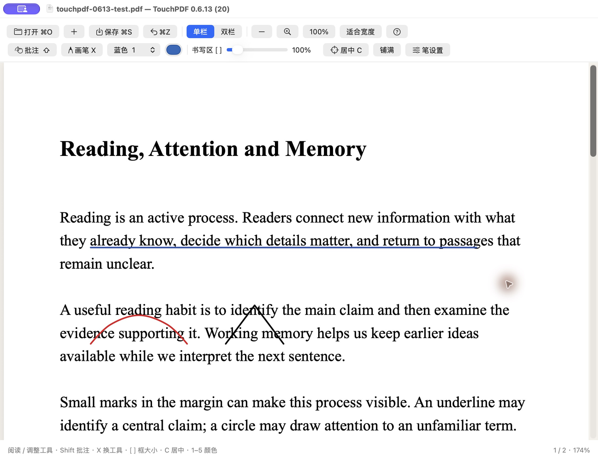
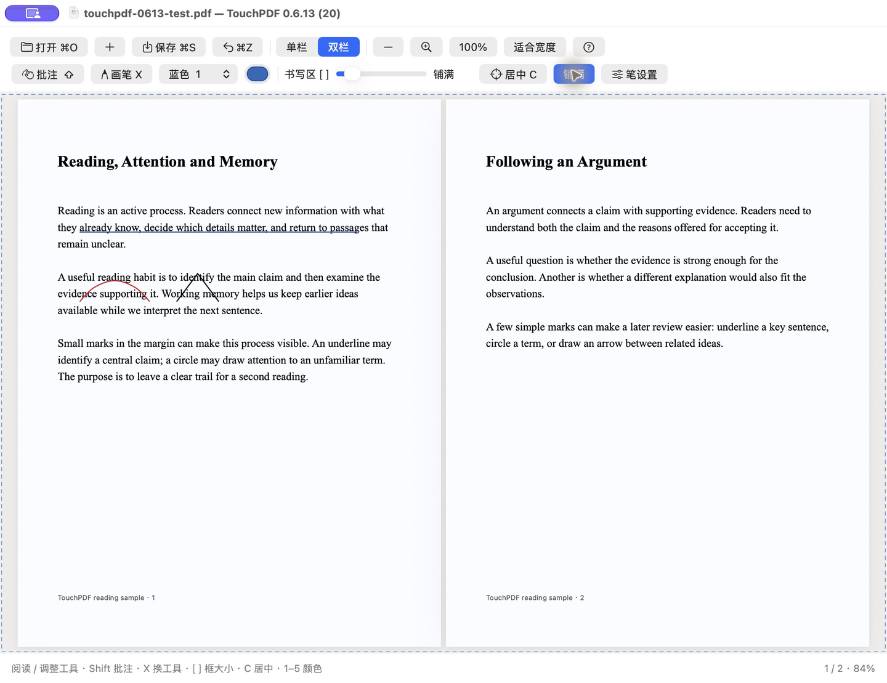

# TouchPDF

### 轻触定位，加力书写。让 Mac 触控板成为你的手写区。

**手指轻放时只移动笔尖，稍微加力就开始写，全程无需按下触控板。**

把公式、解题过程和课堂笔记，直接写在 PDF 上。

**macOS 13+ · Apple Silicon**

[**下载 TouchPDF App**](https://github.com/lux-666/TouchPDF/releases/download/v0.6.13/TouchPDF-0.6.13-macos-arm64.zip) · [查看最新版本](https://github.com/lux-666/TouchPDF/releases/latest)

## 从定位到落笔，靠手指的力度衔接

手指轻放在触控板上，先把笔尖移到想写的位置；稍微加力，移动手指就留下笔迹。开启“减力收笔”后，放轻力度就能停笔并继续定位，再加力写下一笔。也可以选择抬手收笔。

**轻触找位置 → 加力写一笔 → 减力或抬手 → 换位置接着写。**

### 手指放在哪里，笔尖就到哪里

触控板对应屏幕上的蓝色书写框：手指在左上，笔尖就在框的左上；手指在中间，笔尖就在框的中间。抬手后落到另一个位置，就能从那里继续写。

写公式时，可以写完主体，再回到右上角补指数、移到下方写分母；做题时，可以在算式和草图之间来回落笔。定位、书写和换位都在同一块触控板上完成。

### 调到适合自己的书写手感

- **落笔力度可调。** 在“笔设置”中调整门槛，找到轻触定位与加力书写之间适合自己的力度。
- **书写范围可调。** 同样的手指移动，在小书写区里对应更细的位移，方便补小字和公式；放大书写区则方便画图、写长算式。
- **笔迹保留细节。** 平滑细小抖动，同时保留公式的尖角；笔迹按 Retina 分辨率显示，保存为矢量批注。

轻压书写需要兼容触控板，实际力度手感因设备而异，可先在空白画布上调整。

## 用来刷题、记公式、做批注

| 场景 | 随手写下来 |
| --- | --- |
| **刷题练习** | 打开 PDF 题集，圈出条件、写下计算过程，错了就擦掉重写。 |
| **课堂笔记** | 在讲义旁补公式、推导和老师强调的重点。 |
| **阅读批注** | 给论文和教材划线、画箭头，留下自己的理解。 |

## 下载后就能用

1. [下载应用](https://github.com/lux-666/TouchPDF/releases/download/v0.6.13/TouchPDF-0.6.13-macos-arm64.zip)，解压，将 **TouchPDF.app** 拖入“应用程序”。
2. 双击打开，选择一份 PDF，或新建空白画布。
3. 单按 **Shift** 并松开，开始触控板批注。

**首次打开被 macOS 拦截时：**

打开 **系统设置 → 隐私与安全性**，向下找到 TouchPDF 的拦截提示，点击 **“仍要打开”**，按系统提示确认，再点 **“打开”**。该选项会在尝试打开 App 后出现。

## 写、读、调工具，自然切换
- **Shift** 暂停批注，用触控板调整颜色、大小和笔设置，再按一次继续。
- **X** 切换画笔与橡皮。橡皮用范围圈和高亮显示命中的笔画，**⌘Z** 撤销。
- **双指滑动**滚动 PDF，**捏合**缩放，**三指移动**书写框。

蓝色虚线框就是触控板对应的书写区。它可以跨过页边和双栏中间的页缝，也可以一键“铺满”整个阅读区。

## 顺手的工具

**彩色笔迹** — 蓝、黑、红、绿、紫，也可以自选颜色。笔迹平滑保留公式尖角，Retina 显示，保存为矢量批注。

**自由调节书写区** — 40–600% 大小调节，一键居中或铺满；调整书写框不会缩放 PDF 和已有笔迹。铺满时横纵映射比例可能不同；保持手写比例时使用普通大小调节。

**按习惯收笔** — 在“笔设置”中选择减力收笔或抬手收笔，并调整落笔力度。

## 常用快捷键

| 按键 | 操作 | 按键 | 操作 |
| --- | --- | --- | --- |
| **Shift** 单按松开 | 暂停／继续批注 | **X** | 画笔／橡皮 |
| **[ / ]** | 缩小／放大书写区 | **C** | 书写区居中 |
| **1–5** | 切换五种常用颜色 | **Esc** | 返回阅读 |
| **⌘O** | 打开 PDF | **⌘S** | 保存 |
| **⌘Z** | 撤销 | **⇧⌘Z** | 重做 |

工具栏问号里可以查看全部快捷键。暂停批注时，也能调整工具和书写区。

## 保存你的笔记

按 **⌘S** 保存，或用 **⇧⌘S** 另存为。保存的 PDF 可以在系统“预览”等阅读器中继续查看。

**页内笔迹会保存；页缝和页面外的笔迹仅保留在当前会话，关闭后不保留。**

---

[下载 TouchPDF](https://github.com/lux-666/TouchPDF/releases/latest) · [反馈问题](https://github.com/lux-666/TouchPDF/issues) · [MIT License](LICENSE)
